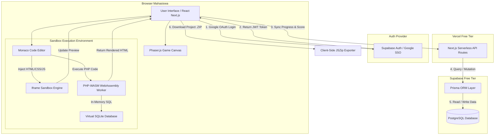
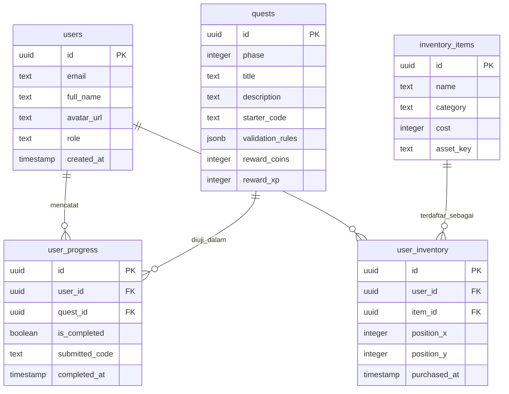

# Product Requirements Document (PRD): Startup Tycoon

## 1. Overview

### Masalah yang Diselesaikan

Proses pembelajaran pemodelan web dasar (*Full-Stack Web Development*) pada tingkat perguruan tinggi sering kali menghadapi kendala besar dalam mempertahankan keterikatan (*engagement*) mahasiswa. Pendekatan dokumentasi kaku sekelas W3Schools secara teoritis sangat lengkap, namun kurang memberikan konteks nyata tentang bagaimana baris kode berdampak langsung pada sistem bisnis.

Di sisi lain, mahasiswa sering kali mengalami frustrasi awal (*friction*) akibat kompleksitas konfigurasi lingkungan pengembangan lokal (*local environment setup*) seperti penyiapan server web Apache/PHP dan basis data pada perangkat mereka. Tanpa umpan balik visual yang interaktif dan intuitif, konsep-konsep abstrak seperti *CSS Box Model*, *DOM Tree*, *JavaScript Event Loop*, serta arsitektur *Client-Server* pada PHP menjadi sulit dipahami secara mendalam.

### Tujuan Aplikasi

Startup Tycoon bertujuan untuk menjembatani teori lengkap pengembangan web dasar dengan pengalaman praktis berbasis gim simulasi bisnis (*business simulation game*). Aplikasi ini memberikan lingkungan *sandbox* berbasis browser tanpa perlu instalasi perangkat lunak tambahan, dengan manfaat utama sebagai berikut:

* **Eliminasi Hambatan Setup:** Seluruh proses penulisan dan eksekusi kode (HTML, CSS, JS, dan PHP) berjalan 100% di dalam browser pengguna.
* **Umpan Balik Visual & Mental Model:** Menyediakan animasi visual interaktif yang mentransformasi kode abstrak menjadi reaksi nyata pada antarmuka gim dan ruang kerja virtual.
* **Pembelajaran Terkontekstualisasi:** Menyajikan seluruh silabus pengembangan web dasar melalui narasi perkembangan bisnis dari garasi hingga perusahaan *Unicorn*.
* **Kemudahan Akses:** Menggunakan autentikasi Google SSO dan infrastruktur cloud gratisan yang hemat daya tanpa membebani server universitas maupun penyedia *hosting*.

---

## 2. Requirements

### Persyaratan Fungsional

* **Autentikasi Single Sign-On (SSO):** Pengguna dapat masuk dan mendaftar menggunakan akun Google (pribadi maupun email institusi kampus) dalam satu kali klik.
* **In-Game Code Editor:** Pengguna dapat mengetik kode HTML, CSS, JavaScript, dan PHP secara langsung di dalam aplikasi dengan fitur *syntax highlighting*, *auto-completion*, dan deteksi kesalahan *syntax*.
* **Real-time Live Preview & Execution Sandbox:** Pengguna dapat melihat hasil eksekusi kode HTML/CSS/JS secara langsung pada panel pratinjau serta mengeksekusi kode PHP di dalam browser menggunakan teknologi WebAssembly (PHP-WASM).
* **Modul Materi Pembelajaran (Holo-Codex):** Pengguna dapat mengakses ensiklopedia materi W3Schools interaktif yang terintegrasi di dalam aplikasi kapan saja.
* **Sistem Validasi Kode & Penilaian:** Aplikasi dapat memeriksa kebenaran struktur DOM, nilai properti CSS, logika fungsi JavaScript, dan luaran skrip PHP secara otomatis untuk menyelesaikan misi.
* **Sistem Progresi & Ekonomi Gim:** Pengguna dapat memperoleh mata uang virtual (*Revenue*) dan poin pengalaman (*XP/Active Users*) dari penyelesaian misi koding untuk merestrukturisasi dan mengagandakan aset kantor virtual.
* **Papan Peringkat (Leaderboard) & Laporan:** Pengguna dan pengajar dapat melihat progres penyelesaian modul, tingkat akurasi kode, serta statistik pencapaian kelas.

### Persyaratan Non-Fungsional

* **Performa Eksekusi:** Waktu pemrosesan dan *render* kode di dalam *sandbox* browser harus berlangsung kurang dari 100 milidetik untuk HTML/CSS/JS dan kurang dari 300 milidetik untuk skrip PHP-WASM.
* **Performa Pemuatan Pertama:** *Initial page load time* aplikasi tidak boleh melebihi 2.5 detik pada koneksi internet standar (10 Mbps).
* **Antarmuka Pengguna (UI/UX):** Mengusung tema *Modern Dark Tech/Cyberpunk Isometric* yang elegan, profesional, dan tidak kekanak-kanakan, dengan responsivitas tinggi pada resolusi layar minimal 1280x720 piksel.
* **Keamanan Execution Sandbox:** Eksekusi kode pengguna harus terisolasi total di dalam *iframe* bersandbox dan *WebAssembly Worker* untuk mencegah serangan *Cross-Site Scripting* (XSS) atau manipulasi sesi browser utama.
* **Efisiensi Infrastruktur:** Arsitektur harus dioptimalkan untuk berjalan sepenuhnya pada batas *Vercel Free Tier* tanpa melampaui kuota *Serverless Function Execution*.

### Asumsi & Batasan

* **Skala Pengguna:** Dirancang untuk menangani hingga 1.000 pengguna aktif harian (*Daily Active Users*) dalam skenario pembelajaran kelas.
* **Batasan Perangkat:** Aplikasi dioptimalkan untuk perangkat *Desktop/Laptop* (Windows, macOS, Linux, Chromebook) menggunakan browser modern berbasis Chromium, Firefox, atau Safari.
* **Batasan Platform Hosting:** Menggunakan Vercel versi gratis sebagai media penyedia static asset dan API ringan, serta Supabase Free Tier untuk penyimpanan basis data dan autentikasi.
* **Bahasa Antarmuka:** Seluruh antarmuka gim, instruksi misi, dan percakapan NPC menggunakan Bahasa Indonesia baku yang profesional, dengan tetap mempertahankan istilah baku teknis bahasa Inggris yang lazim di dunia industri (seperti *array*, *function*, *loop*, *flexbox*, *database*).

---

## 3. Core Features

### Fase 1: Fondasi System & Garasi (Materi HTML)

Fase ini berfokus pada penyediaan arsitektur dasar gim, sistem autentikasi, serta modul pembelajaran struktur web (HTML).

#### In-Game Code Editor & HTML Sandbox Engine

Lingkungan pengembang terintegrasi berbasis *Monaco Editor* yang mendukung manipulasi dokumen HTML dan pratinjau langsung.

* Penyorotan sintaksis (*syntax highlighting*) khusus tag dan atribut HTML5.
* Rendering langsung dokumen ke dalam *sandboxed iframe*.
* Pengecekan struktur *DOM Tree* secara langsung (*real-time*) untuk memicu animasi perakitan komponen fisik di ruangan garasi virtual.

#### Autentikasi Google SSO & Manajemen Profil

Sistem masuk aman tanpa perlu pengelolaan kata sandi manual.

* Integrasi Google OAuth 2.0 via Supabase Auth.
* Sinkronisasi data nama, email, dan foto profil (*avatar*) pengguna dari akun Google.
* Pembatasan domain opsional untuk memastikan hanya mahasiswa dengan email institusi kampus yang dapat mengakses gim.

#### Holo-Codex HTML & Quest Engine

Ensiklopedia materi terintegrasi beserta sistem pemberian misi koding berbasis tiket permintaan klien.

* Modul materi W3Schools untuk tag dasar, atribut, teks, tabel, form, dan HTML *semantics*.
* Validasi otomatis keberadaan tag dan hierarki dokumen.
* Sistem imbalan berupa peningkatan koin awal dan pembukaan item garasi dasar.

---

### Fase 2: Operasional & Co-Working Space (Materi CSS)

Fase ini memperkenalkan modul gaya visual, tata letak, dan responsivitas web menggunakan CSS.

#### Live CSS Injector & Visual Mental Model Engine

Mesin pengenalan dan penerapan CSS yang memvisualisasikan konsep abstrak desain web secara langsung.

* Penerapan gaya CSS secara dinamis ke dalam *preview iframe*.
* **Animasi Inspector Box Model:** Visualisasi sinar X-Ray yang memperlihatkan area *content*, *padding*, *border*, dan *margin* membesar/menyusut sesuai nilai kode yang diketik.
* **Flexbox & Grid Visualizer:** Animasi penataan rak barang atau tata letak kantor yang bergerak secara presisi saat atribut `display: flex` atau `grid` diubah.

#### Sistem Dekorasi & Ekspansi Kantor

Mekanisme belanja aset interior yang berdampak pada estetika dan performa permainan.

* Katalog pembelian meja, laptop, pendingin udara, dan dekorasi kantor menggunakan koin gim.
* Efek bonus pasif (*buff*) dari aset interior, seperti petunjuk sintaksis otomatis atau percepatan perolehan poin pengalaman.

---

### Fase 3: Scaling & High-Rise Tower (Materi JavaScript)

Fase ini berfokus pada logika pemrograman, manipulasi antarmuka, dan komunikasi data *asynchronous*.

#### JS Client Engine & Event Loop Visualizer

Lingkungan eksekusi JavaScript terisolasi yang mampu menjalankan logika antarmuka dan memvisualisasikan eksekusi kode.

* Evaluasi kode JS aman di dalam *web worker/iframe sandbox*.
* **Animasi Event Loop:** Visualisasi proses *Call Stack*, *Web APIs*, dan *Callback Queue* yang digambarkan sebagai sistem ban berjalan (*conveyor belt*) data kantor.
* Simulator interaksi tombol pengguna untuk menguji *Event Listener* (`click`, `submit`, `hover`).

#### Papan Peringkat & Analitik Kelas

Panel pemantauan performa dan kompetisi antar mahasiswa.

* Papan peringkat (*Leaderboard*) berdasarkan total *Revenue* perusahaan dan kecepatan penyelesaian misi.
* Dasbor pemantauan bagi pengajar untuk melihat tingkat keberhasilan dan area kebuntuan (*bottleneck*) koding mahasiswa.

---

### Fase 4: Enterprise & Penthouse (Materi PHP & Database)

Fase ini menghadirkan eksekusi skrip *backend* serverless di dalam browser dan pengelolaan data relasional.

#### In-Browser PHP-WASM Execution Sandbox

Mesin penyaji kode PHP yang berjalan sepenuhnya di sisi klien (*client-side*) menggunakan teknologi WebAssembly.

* Kompilasi dan eksekusi skrip PHP versi 8.x langsung di dalam browser pengguna tanpa server PHP eksternal.
* Visualisasi alur *Client-Server*: Animasi paket data bercahaya yang meluncur dari komputer *Client*, diproses oleh mesin *PHP-WASM*, dan menghasilkan dokumen HTML baru.
* Pengolahan form dinamis (`$_GET`, `$_POST`), manajemen *session*, dan enkripsi kata sandi.

#### Virtual MySQL Database & Integrated SQL Manager

Simulasi sistem basis data relasional untuk melatih logika penyetoran dan pengambilan data.

* Basis data SQLite/IndexedDB terisolasi di browser yang menerima sintaksis *SQL/PDO PHP*.
* Pengecekan *Prepared Statements* untuk mencegah simulasi peretasan *SQL Injection* pada misi keamanan siber.
* Ekspor portofolio proyek akhir mahasiswa menjadi berkas kode sumber siap pakai (`.zip`).

---

## 4. User Flow

```
+-----------------------------------------------------------------------------------+
| 1. Registrasi / SSO  -->  2. Inisialisasi Karakter  -->  3. Akses Dashboard Gim   |
| (Fase 1: Auth)            (Setup Profil)                 (Karakter & Aset Garasi) |
+-----------------------------------------------------------------------------------+
                                                              |
                                                              v
+-----------------------------------------------------------------------------------+
| 6. Pembelian Dekorasi <-- 5. Eksekusi & Validasi  <-- 4. Buka Misi & Holo-Codex   |
| (Fase 2: Ekspansi)        (Fase 1-4: Code Sandbox)       (Fase 1-4: Quest Engine)  |
+-----------------------------------------------------------------------------------+
        |
        v
+-----------------------------------------------------------------------------------+
| 7. Transisi Babak    -->  8. Papan Peringkat & IPO -->  9. Ekspor Portofolio      |
| (Upgrade Gedung)          (Fase 3: Leaderboard)          (Fase 4: Final Project)  |
+-----------------------------------------------------------------------------------+

```

1. **Registrasi & Autentikasi [Fase 1]:** Pengguna membuka aplikasi di browser, memilih tombol "Masuk dengan Google", melakukan otorisasi akun Google SSO, dan langsung diarahkan ke dalam sistem tanpa perlu konfirmasi email manual.
2. **Setup Awal Perusahaan:** Pengguna memasukkan nama *startup* mereka dan memilih avatar pendiri perusahaan.
3. **Memulai Garasi Virtual [Fase 1]:** Pengguna masuk ke tampilan utama gim. Layar kiri menampilkan kondisi garasi tua, layar tengah menampilkan Monaco Editor, dan layar kanan menampilkan aplikasi target serta jendela *Holo-Codex*.
4. **Menerima Misi Pertama (HTML) [Fase 1]:** Pengguna membuka tiket pekerjaan dari klien, membaca teori dasar di Holo-Codex, dan menuliskan kode HTML yang diminta di editor.
5. **Eksekusi dan Validasi Kode [Fase 1-4]:** Pengguna menekan tombol "Deploy Code". Sistem mengecek kebenaran kode secara otomatis. Jika berhasil, animasi di layar kiri akan memperbarui kondisi ruangan garasi, memberikan koin, dan menambahkan poin pengalaman.
6. **Membeli Upgrade & Mengatur Layout (CSS) [Fase 2]:** Pengguna menggunakan koin untuk membeli meja baru. Pada misi CSS, pengguna mengatur posisi meja dan dekorasi kantor menggunakan kode *Flexbox* dan *Grid* yang memicu animasi perenggangan *Box Model*.
7. **Mengembangkan Logika Interaktif (JS) [Fase 3]:** Pengguna naik ke babak *Co-Working Space* dan *High-Rise Tower*, menyelesaikan misi manipulasi DOM, pengolahan form, dan pemicuan efek suara/animasi interaktif dengan JavaScript.
8. **Membangun Backend & Database (PHP) [Fase 4]:** Pengguna mencapai babak *Penthouse*, menulis kode pemrosesan form PHP dan query basis data yang dieksekusi langsung oleh *PHP-WASM Engine* di browser.
9. **Melihat Laporan & Ekspor [Fase 3 & 4]:** Pengguna dapat memeriksa posisi mereka pada papan peringkat (*Leaderboard*) kelas, melihat statistik penyelesaian modul, dan mengunduh seluruh proyek kode yang telah dibuat menjadi berkas zip untuk portofolio dunia nyata.

---

## 5. Architecture

Aplikasi menggunakan pendekatan *Client-Centric Web Architecture*. Seluruh beban eksekusi kode mahasiswa dipindahkan sepenuhnya ke browser pengguna (*client-side*). Vercel bertugas menyajikan aset statis dan API Serverless ringan, sedangkan Supabase bertugas menangani otentikasi OAuth dan penyimpanan status basis data.

### High-Level System Overview

* **Front-End Layer:** Dibangun menggunakan Next.js (App Router) yang menyajikan antarmuka pengguna, Monaco Editor, Phaser.js Game Canvas, dan komponen UI Shadcn.
* **Execution Sandbox Layer (Client-Side):**
* **HTML/CSS/JS Sandbox:** Dijalankan di dalam `<iframe>` terisolasi dengan pembatasan hak akses (*security policy*).
* **PHP Execution Engine:** Menggunakan `@php-wasm/web` (WebAssembly) yang menjalankan *runtime* PHP penuh di dalam *Web Worker* browser pengguna.


* **Backend & Database Layer (Managed Services):**
* **API Layer:** Next.js Route Handlers / Serverless Functions pada Vercel untuk sinkronisasi nilai dan progres.
* **Auth Provider:** Supabase Auth untuk verifikasi token Google OAuth 2.0.
* **Database:** Supabase PostgreSQL yang diakses menggunakan Prisma ORM.


### System Architecture Flowchart



---

## 6. Database Schema

### Tabel Database Utama

#### 1. `users`

Menyimpan data identitas profil pengguna yang terhubung dengan Supabase Auth.

| Kolom | Tipe | Kegunaan |
| --- | --- | --- |
| `id` | uuid | Identifier unik pengguna (Primary Key, Foreign Key ke Supabase Auth). |
| `email` | text | Alamat email terverifikasi pengguna dari Google SSO. |
| `full_name` | text | Nama lengkap pengguna dari profil Google. |
| `avatar_url` | text | Tautan foto profil pengguna dari Google. |
| `role` | text | Peran pengguna dalam aplikasi (`student` atau `lecturer`). |
| `created_at` | timestamp | Waktu pembuatan akun. |

#### 2. `quests`

Menyimpan katalog modul, misi koding, dan aturan validasi jawaban.

| Kolom | Tipe | Kegunaan |
| --- | --- | --- |
| `id` | uuid | Identifier unik misi (Primary Key). |
| `phase` | integer | Angka babak permainan (1: HTML, 2: CSS, 3: JS, 4: PHP). |
| `title` | text | Judul misi koding. |
| `description` | text | Deskripsi naratif dan instruksi teknis misi. |
| `starter_code` | text | Kode awal yang diberikan di editor saat misi dibuka. |
| `validation_rules` | jsonb | Aturan pengujian terstruktur untuk memeriksa kebenaran kode. |
| `reward_coins` | integer | Jumlah koin virtual yang didapat jika misi selesai. |
| `reward_xp` | integer | Jumlah poin pengalaman yang didapat jika misi selesai. |

#### 3. `user_progress`

Mencatat status penyelesaian misi dan perolehan poin setiap pengguna.

| Kolom | Tipe | Kegunaan |
| --- | --- | --- |
| `id` | uuid | Identifier unik rekaman progres (Primary Key). |
| `user_id` | uuid | Relasi ke tabel `users` (Foreign Key). |
| `quest_id` | uuid | Relasi ke tabel `quests` (Foreign Key). |
| `is_completed` | boolean | Penanda apakah misi telah berhasil diselesaikan. |
| `submitted_code` | text | Kode jawaban terakhir yang dikirimkan oleh pengguna. |
| `completed_at` | timestamp | Waktu penyelesaian misi. |

#### 4. `inventory_items`

Katalog aset dekorasi dan barang yang dapat dibeli di dalam gim.

| Kolom | Tipe | Kegunaan |
| --- | --- | --- |
| `id` | uuid | Identifier unik barang (Primary Key). |
| `name` | text | Nama barang dekorasi (misal: "Meja Kerja Kayu", "Server Rack"). |
| `category` | text | Kategori barang (`furniture`, `electronics`, `decoration`). |
| `cost` | integer | Harga barang dalam mata uang koin virtual. |
| `asset_key` | text | Kunci pemetaan file gambar/sprite pada Phaser.js. |

#### 5. `user_inventory`

Mencatat kepemilikan dan penataan posisi barang dekorasi pengguna.

| Kolom | Tipe | Kegunaan |
| --- | --- | --- |
| `id` | uuid | Identifier unik inventaris (Primary Key). |
| `user_id` | uuid | Relasi ke tabel `users` (Foreign Key). |
| `item_id` | uuid | Relasi ke tabel `inventory_items` (Foreign Key). |
| `position_x` | integer | Koordinat sumbu X penempatan barang di ruangan virtual. |
| `position_y` | integer | Koordinat sumbu Y penempatan barang di ruangan virtual. |
| `purchased_at` | timestamp | Waktu pembelian barang. |

---

### Entity-Relationship (ER) Diagram



---

## 7. Tech Stack

### Framework Utama (Frontend & API Layer)

* **Next.js (v14+ App Router) / React (v18+):** Framework React modern berbasis TypeScript untuk membangun antarmuka terstruktur, optimasi aset statis, dan eksekusi API Route serverless secara efisien.
* *Alasan:* Sangat optimal untuk infrastruktur Vercel, mendukung *Server-Side Rendering* (SSR) untuk pemuatan awal yang cepat, serta *Client Components* untuk interaktivitas gim.

### UI, Styling, & Game Engine

* **Tailwind CSS & Shadcn UI:** Framework CSS utilitas dan pustaka komponen antarmuka berkualitas tinggi bertema gelap (*Dark Mode*).
* **Framer Motion:** Pustaka animasi deklaratif untuk animasi transisi UI, panel modal, dan efek *Mental Model* visual (seperti animasi membesarnya *Box Model*).
* **Phaser.js (v3.80+):** Framework gim HTML5 2D berbasis Canvas.
* *Alasan:* Ringan dan sangat andal untuk mengolah grafik isometrik 2D ruangan kantor virtual tanpa membebani memori browser.

### In-Game Editor & Code Execution

* **`@monaco-editor/react`:** Komponen editor kode berbasis Web yang menggerakkan Visual Studio Code.
* **`@php-wasm/web`:** Engine *PHP WebAssembly* yang memungkinkan eksekusi kode PHP 8.x sepenuhnya di dalam *Web Worker* browser pengguna.
* *Alasan:* Menghilangkan kebutuhan server PHP eksternal sehingga aplikasi dapat di-deploy 100% secara gratis di Vercel tanpa biaya CPU server.

### ORM & Basis Data

* **Supabase PostgreSQL (v15+):** Basis data relasional terkelola berbasis cloud.
* **Prisma ORM (v5+):** Pustaka Object-Relational Mapping bertipe aman (*type-safe*) untuk interaksi basis data dari Next.js API Routes.
* *Alasan:* Menyediakan kuota gratis (*Free Tier*) yang melimpah (500MB storage), performa tinggi, dan kemudahan manajemen relasi tabel.

### Autentikasi

* **Supabase Auth (Google OAuth 2.0 Provider):** Layanan autentikasi terkelola yang terhubung langsung dengan Google Cloud Console.
* *Alasan:* Gratis, mendukung integrasi Google SSO secara instan, dan otomatis menghasilkan token JSON Web Token (JWT) yang aman untuk identifikasi API.

### Deployment & Infrastruktur

* **Vercel Global Edge Network (Free Tier):** Platform hosting otomatis yang terintegrasi langsung dengan repositori GitHub.
* *Alasan:* Penanganan deployment statis tanpa batas biaya, dukungan sertifikasi SSL otomatis, dan integrasi bawaan dengan framework Next.js.

### Pustaka Pendukung

* **Zod:** Pustaka validasi skema data TypeScript untuk memeriksa aturan JSON pada *Quest Engine*.
* **JSZip & FileSaver:** Pustaka di sisi klien untuk mengompres dan mengunduh seluruh berkas kode buatan mahasiswa menjadi file `.zip`.
* **Lucide React:** Koleksi ikon vektor modern berskala ringan untuk antarmuka pengguna.